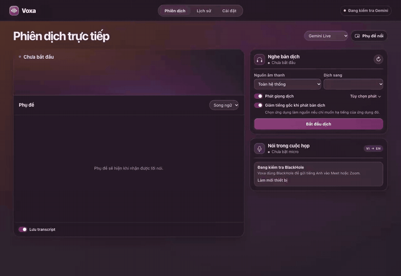
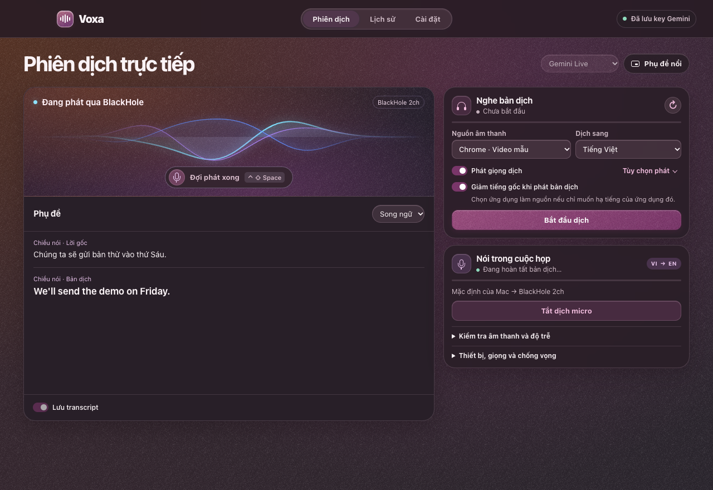
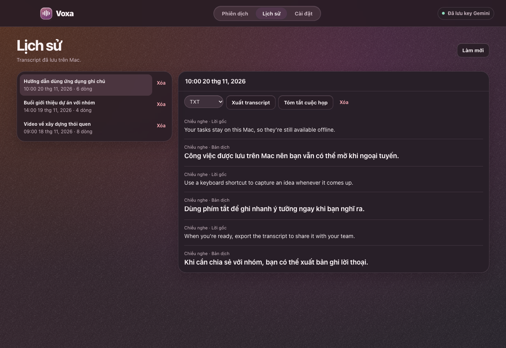

# Voxa

**An open-source, real-time interpreter for macOS.** Follow videos and meetings with bilingual captions and spoken translation, or speak Vietnamese and route the English translation into a call.

[Tiếng Việt](docs/huong-dan.md) · [Contributing](CONTRIBUTING.md)

## See Voxa in action



[Watch the full-size MP4](https://raw.githubusercontent.com/hiimbomb1999/voxa/main/docs/media/voxa-demo.mp4) · [View the live captions screenshot](docs/media/live-captions.png)

*The demo and screenshots use synthetic captions and device labels.*

## What you can do

- **Follow videos and calls.** Capture system audio or one app, choose a target language, and read bilingual or floating captions. Voxa can lower the original audio while the translation plays.
- **Speak in a meeting.** Hold **Control + Shift + Space** to speak Vietnamese and send the English audio through **BlackHole 2ch** as the microphone input in Google Meet or Zoom.
- **Choose how translation is produced.** Gemini Live streams translated voice directly. Soniox streams original and translated captions and can read the translation with its own TTS. Optional VieNeu-TTS produces Vietnamese and English speech locally from translated text.
- **Keep a record.** Save transcripts to SQLite on the Mac, export TXT, SRT or Markdown, and delete individual sessions. Gemini supports optional summaries and a push-to-talk assistant.

| Meeting audio controls | Transcript history |
| --- | --- |
|  |  |

## Build and run

Requirements are **macOS 14.2 or later**, **Xcode Command Line Tools**, and **Rust stable**. The current packaging workflow targets Apple Silicon.

```sh
git clone https://github.com/hiimbomb1999/voxa.git
cd voxa
./scripts/bundle.sh
open release/Voxa.app
```

1. In **Cài đặt** (Settings), enter your own [Gemini](https://aistudio.google.com/apikey) or [Soniox](https://console.soniox.com/) API key. Select the provider in **Phiên dịch**.
2. Select the audio source and target language. Start translation and grant **System Audio Recording** when macOS asks.
3. To send your English voice into a meeting, install [BlackHole 2ch](https://github.com/ExistentialAudio/BlackHole/wiki/Use-BlackHole-as-a-Virtual-Microphone). Select your physical microphone in Voxa and BlackHole as the microphone in the meeting. Keep the meeting's speaker routed to headphones or speakers.

For local speech playback, install [uv](https://docs.astral.sh/uv/getting-started/installation/) and run `./scripts/install-vieneu.sh` from the checkout. Then refresh voices in Voxa. The [Vietnamese guide](docs/huong-dan.md) walks through routing tests and troubleshooting.

## Data and current limits

- API keys are stored in macOS Keychain. Cloud translation sends captured audio to the selected provider. Cloud TTS receives the translated text, and requesting a Gemini summary sends the selected transcript to Gemini. Provider quotas, pricing, and data policies apply.
- Transcript saving is optional. Voxa stores saved text and time markers locally. VieNeu runs speech synthesis locally while speech recognition and translation still use a cloud provider.
- Voxa processes the audio stream while the source app controls video playback. Translation adds latency, and Voxa can omit overdue audio to catch up while keeping the translated text in captions.
- Builds produced by the script are ad hoc signed for local development. End-to-end quality depends on the provider, language, and hardware routing.

## Development

```sh
cargo fmt --manifest-path src-tauri/Cargo.toml -- --check
cargo clippy --locked --all-targets --features custom-protocol --manifest-path src-tauri/Cargo.toml -- -D warnings
cargo test --locked --all-targets --features custom-protocol --manifest-path src-tauri/Cargo.toml
```

Rust runs session orchestration and provider transports. Core Audio and CPAL capture and play audio. Tauri hosts the desktop interface, and SQLite stores transcripts. Tests use synthetic audio and loopback provider fixtures.

Ideas for contributions include end-to-end latency benchmarks, better Bluetooth routing diagnostics, English UI strings, and a signed and notarized macOS release.

## License

Voxa's source code is available under the [MIT License](LICENSE). Optional tools, drivers, and model weights are distributed separately under their respective terms, including [BlackHole](https://github.com/ExistentialAudio/BlackHole) and [VieNeu-TTS](https://github.com/pnnbao97/VieNeu-TTS).
